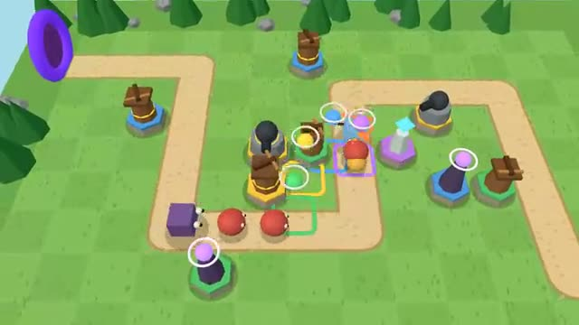

# Tower Defense

Build towers together. Hold the path. A multiplayer starter game from [Multiplayer Agent](https://multiplayeragent.com): 3D, co-op, 1–4 players, with AI builders that fill empty seats.

## How it plays

Enemies walk the path in waves. Spend the team's shared gold on archers, cannons, frost and spark towers, and upgrade them. Lose 20 lives and the castle falls.

**Controls:** Pick a tower, then click or tap a tile. Click a tower to upgrade or sell it. Keys 1 to 4 pick a tower, Space sends the next wave early.

## Make it yours in the Game Builder

Open the [Game Builder](https://multiplayeragent.com), choose **Start from a starter game** and pick Tower Defense. It opens as version 1 in your studio, ready to play and publish. Then ask for changes, for example:

- Add a flying enemy that skips the path
- Add a poison tower that hurts enemies over time
- Add a second map with two paths

## Run it yourself

1. Get a free publishable key (`pk_…`) at [multiplayeragent.com](https://multiplayeragent.com).
2. In `index.html`, put it in place of `pk_REPLACE_ME` in the `MP_CONNECT` block.
3. Serve the folder (for example `npx serve`) and open it. The 3D engine loads as a module, which browsers block from a file on disk.

Without a key it still runs, offline with AI builders.

## How it is built

- One `index.html` plus three.js in `libs/`. The comment at the top of the script maps the code and explains the multiplayer.
- **Host-run rules:** The host's browser moves the enemies, runs the waves and keeps the shared gold; if it leaves, the next player takes over.
- **Leaderboard:** The furthest wave your team reached.
- **Bots:** AI builders place and upgrade towers until enough people join.
- **Live sync:** Everyone sees each other's cursors, towers and shots as they happen.
- `?attract` runs it offline with AI builders only. The preview video is recorded from it.

## License

MIT. three.js in `libs/` is MIT too (Copyright 2010-2024 three.js authors).
